# Lab 3: REST API, query parameters, validation, debugging

**Name:** Thammala Saketh
**Registration Number:** 252U1R7090
**Section:** CSE FSD - 2B
**Course:** Backend Development Fundamentals

## Live Link

[ADD YOUR RENDER URL HERE]

## What this lab does

Lab 2's book routes are rebuilt as a proper REST API. `GET /books/` can search by title, sort, paginate and filter by price. `POST` and `PUT` check the request body before touching the database. Every response uses the right status code, and every error comes back in the same JSON shape: `{ "message": "..." }`.

## How to Run

Requirements: Node.js and npm. No environment variables are required. The server reads `PORT` if it is set, otherwise it uses 3000.

```
cd lab-03
npm install
npm start
```

For auto-restart while editing, use `npm run dev` (nodemon).

Packages: `express` (v5), `sqlite`, `sqlite3` (pinned to 5.1.7) and `nodemon` (development only).

The database file is `books.db`, with one table: `book(id INTEGER PRIMARY KEY, title TEXT, author TEXT, price INTEGER, pages INTEGER)`. To reset it to the 10 starting books, run `seed.sql` against it: `sqlite3 books.db < seed.sql`.

## Project structure

```
lab-03/
├── server.js                 start-up: opens the database, starts listening
├── app.js                    Express app: JSON parsing, routes, 404 and error handler
├── db.js                     opens books.db and shares the connection
├── routes/books.js           the five /books routes
├── middleware/validators.js  checks :bookId and the POST/PUT body
├── utils/HttpError.js        error class that carries a status code
├── utils/listQuery.js        reads and checks the GET /books/ query parameters
├── seed.sql                  creates the table and inserts 10 books
├── books.db                  SQLite database
└── lab-03.postman_collection.json
```

## Endpoints

| Method | Path | Description | Success status |
| --- | --- | --- | --- |
| GET | `/books/` | List books (search, sort, pagination, price filter) | 200 |
| GET | `/books/:bookId/` | Get one book | 200 |
| POST | `/books/` | Create a book from the JSON body | 201 |
| PUT | `/books/:bookId/` | Replace all fields of an existing book | 200 |
| DELETE | `/books/:bookId/` | Delete a book | 200 |

### Query parameters for GET /books/

| Parameter | Meaning | Default | Allowed |
| --- | --- | --- | --- |
| `search_q` | Partial title match, not case sensitive (`LIKE`) | empty (all books) | any text |
| `order_by` | Column to sort on | `id` | `id`, `title`, `author`, `price`, `pages` |
| `order` | Sort direction | `ASC` | `ASC`, `DESC` |
| `limit` | Number of books to return | 10 | whole number 1 to 100 |
| `offset` | Number of books to skip | 0 | whole number, 0 or more |
| `min_price` | Lowest price to include | 0 | whole number, 0 or more |
| `max_price` | Highest price to include | 1000000000 | whole number, 0 or more |

Example: `/books/?search_q=python&min_price=500&max_price=800&order_by=price&order=DESC&limit=5`

### Body for POST and PUT

```json
{
  "title": "Clean Code",
  "author": "Robert C. Martin",
  "price": 580,
  "pages": 464
}
```

`title` and `author` must be non-empty text. `price` and `pages` must be whole JSON numbers, 0 or more. Text such as `"abc"` (or even `"599"` in quotes) is rejected with 400.

### Status codes

| Situation | Status |
| --- | --- |
| Book created | 201 |
| Read, update or delete worked | 200 |
| Bad input: missing or wrong body field, bad id, bad query parameter, broken JSON | 400 |
| Book id not found, or unknown route | 404 |
| Unexpected server fault | 500 |

All errors look like `{ "message": "..." }`.

## Security notes

- Every user value reaches SQLite through `?` placeholders. No SQL is built by joining user input into a string.
- `order_by` and `order` cannot be placeholders, so they are compared against fixed lists first. Anything else gets a 400.
- `%` and `_` typed into `search_q` are escaped so they are searched as normal characters.

## Postman Tests

`lab-03.postman_collection.json` has 34 requests (14 success, 20 failure), each with automatic checks on status code and message. Import it into Postman, set the collection variable `baseUrl` (default `http://localhost:3000`, or your Render URL) and use **Run collection** so the requests run in order. The "Create a book" request stores the new id in `newBookId`, which the update, read and delete requests then use.

### Success cases

| # | Test | Request | Expected |
| --- | --- | --- | --- |
| 01 | List books with defaults | `GET /books/` | 200 |
| 02 | Get one book | `GET /books/3/` | 200 |
| 03 | Search title: python | `GET /books/?search_q=python` | 200 |
| 04 | Search is not case sensitive | `GET /books/?search_q=ALGORITHMS` | 200 |
| 05 | Sort by price, highest first | `GET /books/?order_by=price&order=DESC&limit=5` | 200 |
| 06 | Sort by title, A to Z | `GET /books/?order_by=title&order=ASC` | 200 |
| 07 | Pagination | `GET /books/?limit=3&offset=3` | 200 |
| 08 | Price range 500 to 700 | `GET /books/?min_price=500&max_price=700` | 200 |
| 09 | All filters together | `GET /books/?search_q=o&min_price=500&max_price=1300&order_by=pages&order=DESC&limit=3&offset=1` | 200 |
| 10 | SQL injection text is harmless | `GET /books/?search_q=%27%20OR%201%3D1%20--` | 200 |
| 11 | Create a book | `POST /books/` | 201 |
| 12 | Update the new book | `PUT /books/{{newBookId}}/` | 200 |
| 13 | Read the updated book | `GET /books/{{newBookId}}/` | 200 |
| 14 | Delete the new book | `DELETE /books/{{newBookId}}/` | 200 |

### Failure cases

| # | Test | Request | Expected |
| --- | --- | --- | --- |
| 15 | Book id does not exist | `GET /books/999/` | 404 |
| 16 | Book id is not a number | `GET /books/abc/` | 400 |
| 17 | Deleted book is really gone | `GET /books/{{newBookId}}/` | 404 |
| 18 | Delete the same book again | `DELETE /books/{{newBookId}}/` | 404 |
| 19 | Update a book that does not exist | `PUT /books/999/` | 404 |
| 20 | Create without title | `POST /books/` | 400 |
| 21 | Create without author | `POST /books/` | 400 |
| 22 | Create with text price | `POST /books/` | 400 |
| 23 | Create with negative price | `POST /books/` | 400 |
| 24 | Create without pages | `POST /books/` | 400 |
| 25 | Create with broken JSON | `POST /books/` | 400 |
| 26 | Update with invalid body | `PUT /books/1/` | 400 |
| 27 | Update with bad id | `PUT /books/abc/` | 400 |
| 28 | Invalid order_by | `GET /books/?order_by=hack` | 400 |
| 29 | Invalid order | `GET /books/?order=SIDEWAYS` | 400 |
| 30 | limit is zero | `GET /books/?limit=0` | 400 |
| 31 | limit is not a number | `GET /books/?limit=abc` | 400 |
| 32 | offset is negative | `GET /books/?offset=-1` | 400 |
| 33 | min_price above max_price | `GET /books/?min_price=900&max_price=100` | 400 |
| 34 | Unknown route | `GET /shelves/` | 404 |

## Screenshots

[ADD YOUR OWN SCREENSHOTS: run the server, send each request in Postman, and save the images in `screenshots/` with these names]

### Search by title
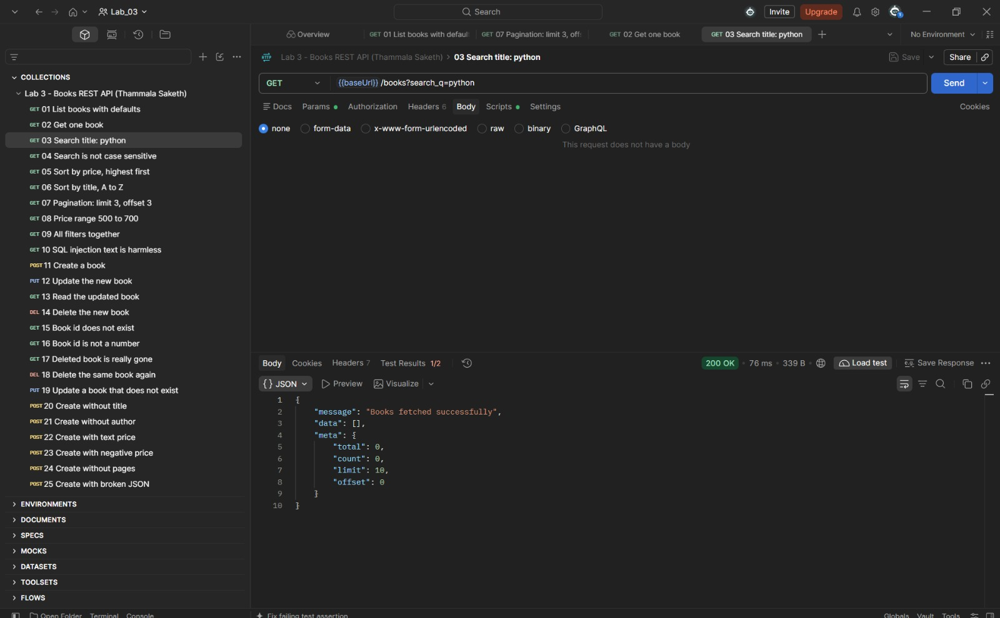

### Sort by price, highest first
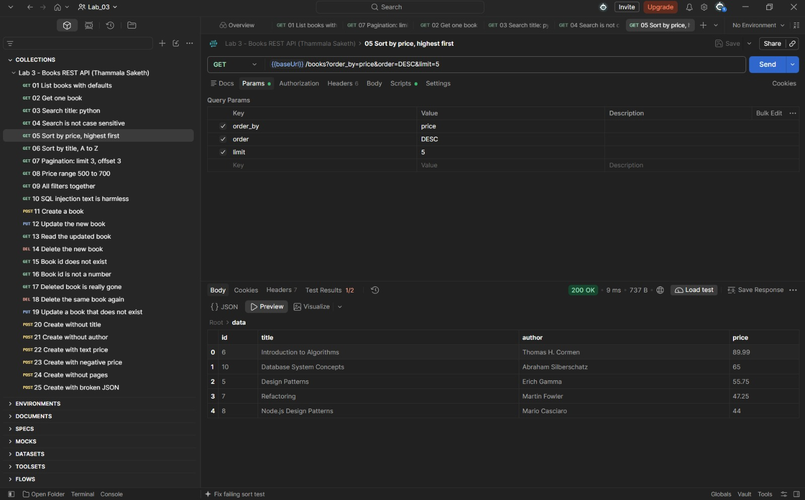

### Pagination
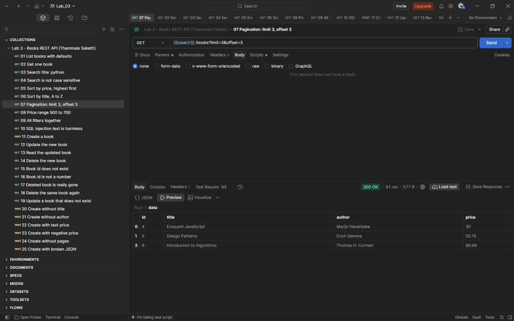

### Price range filter
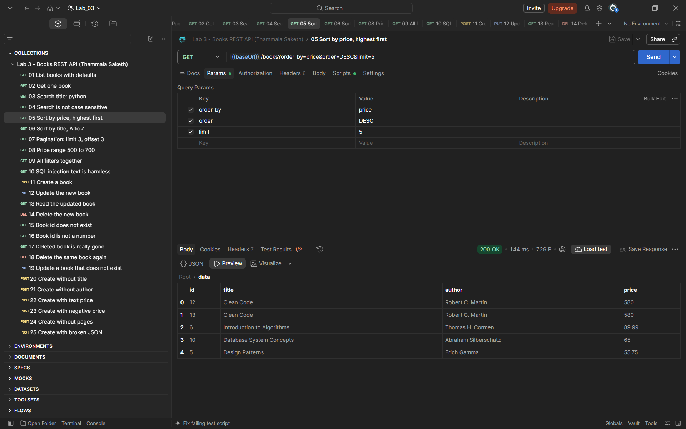

### POST creates a book (201)
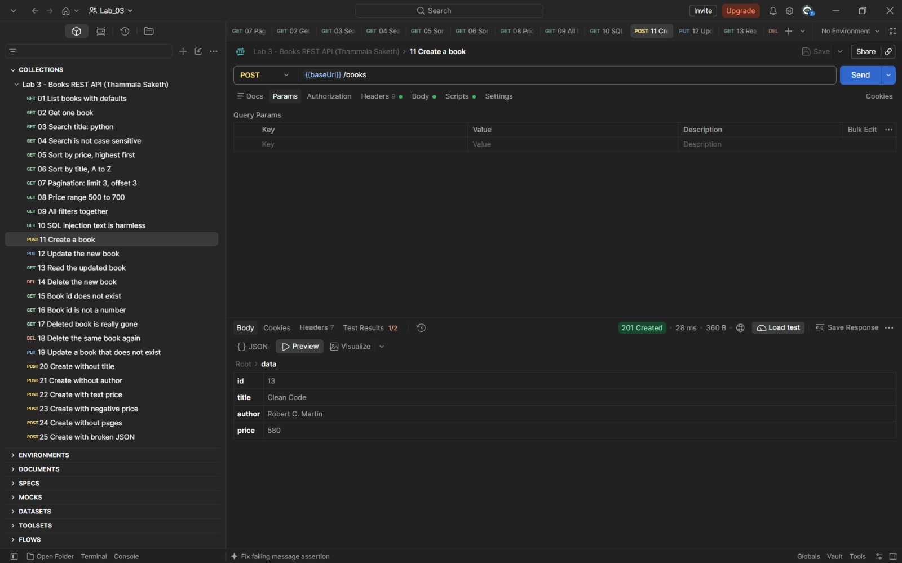

### PUT updates a book (200)
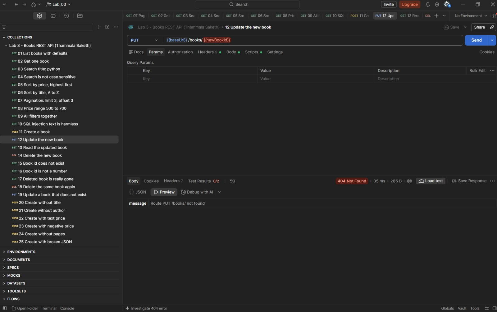

### DELETE removes a book (200)
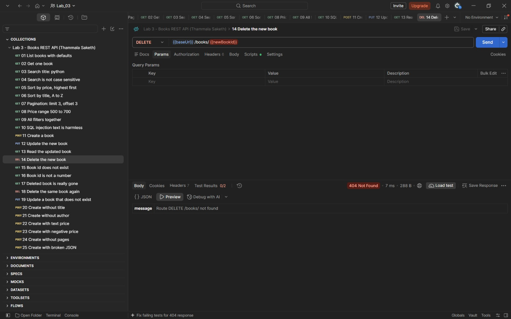

### Validation error: missing title (400)
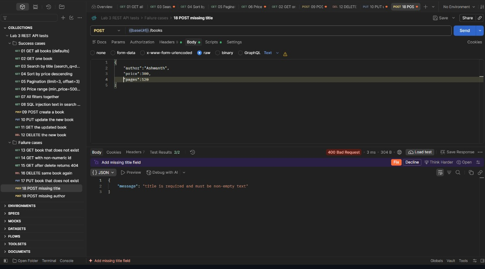

### Validation error: text price (400)
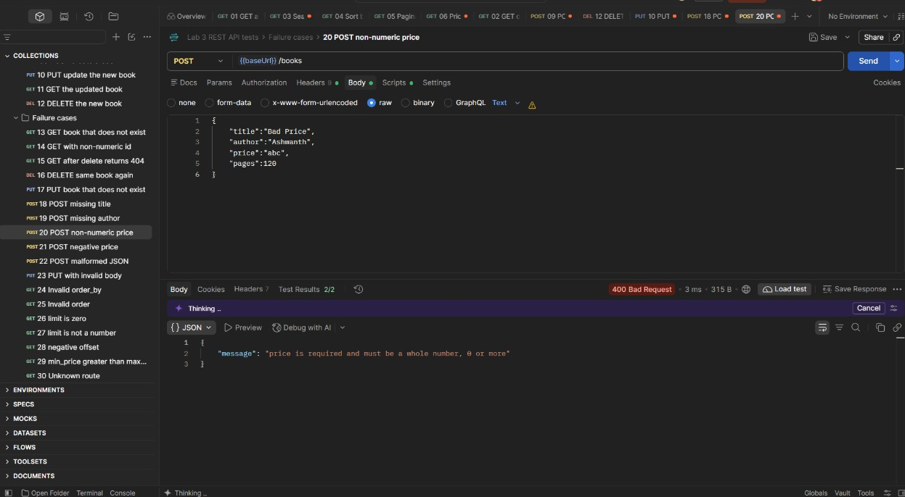

### Book not found (404)
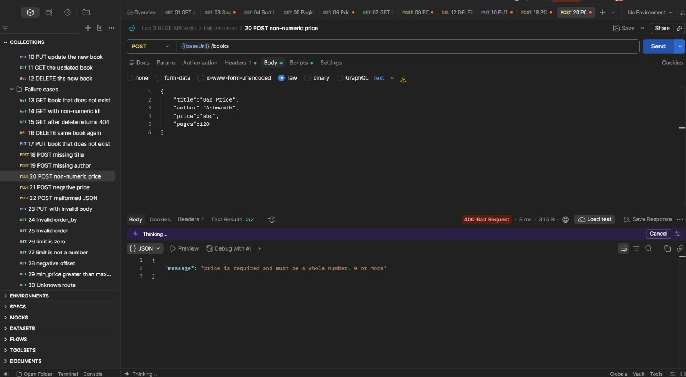

### Collection runner: all tests passing
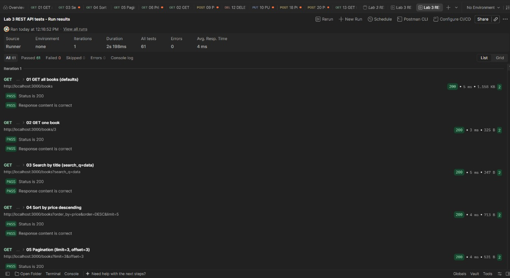

## Debugging Exercise

The faculty gave a broken copy of the project with four errors. Fill this table from what you actually saw.

| Error | Message I saw | Cause | Fix |
| --- | --- | --- | --- |
| Port conflict (EADDRINUSE) | [WRITE YOUR OWN] | [WRITE YOUR OWN] | [WRITE YOUR OWN] |
| Wrong import path | [WRITE YOUR OWN] | [WRITE YOUR OWN] | [WRITE YOUR OWN] |
| Table name typo (no such table) | [WRITE YOUR OWN] | [WRITE YOUR OWN] | [WRITE YOUR OWN] |
| Missing await | [WRITE YOUR OWN] | [WRITE YOUR OWN] | [WRITE YOUR OWN] |

## Notes

Problems faced and how I solved them:

- [WRITE YOUR OWN]
